# Architecture and implementation

SignalDesk is a small authentication-log investigation assistant. The browser detects patterns using fixed rules; a pretrained local model optionally explains one finding. No model training is performed.

## Data flow

```mermaid
flowchart LR
    A[Log file or pasted text] --> B[Parse and normalize in browser]
    B --> C[Three fixed detection rules]
    C --> D[Findings and evidence IDs]
    D --> E[Analyst review and export]
    D --> F[Optional local Node companion]
    F --> G[Recompute finding from logs]
    G --> H[Selected normalized evidence]
    H --> I[Local Ollama model: thinking off]
    I --> J[Check evidence reference IDs]
    J --> E
```

## Modules

| File | Responsibility |
|---|---|
| `dist/core.mjs` | Parse input, normalize timestamps and addresses, sort events, detect rules, build deterministic explanations, generate sample logs. |
| `dist/app.mjs` | Browser state, input handling, findings, event search, model connection, report export. |
| `dist/workbench.mjs` | Activity timeline, analyst notes, review status, Markdown reports. |
| `dist/evaluation.mjs` | Validate labelled suites and calculate case/rule metrics. |
| `dist/evaluation-ui.mjs` | Import cases, show metrics, inspect cases, download results. |
| `server.mjs` | Serve the local app and call Ollama through loopback. |
| `scripts/doctor.mjs` | Report Node availability and the reachable Ollama models. |
| `scripts/evaluate.mjs` | Reproduce rule evaluation from the terminal. |
| `scripts/evaluate-llm.mjs` | Run three real-model smoke tests and preserve prompts, answers, and timings. |

## Parsing and rule behavior

Accepted input: JSON, JSONL, CSV with quoted fields, or ISO-dated SSH authentication lines. The parser accepts up to 2 MB and 20,000 records. It requires timestamps with explicit timezones, normalizes them to UTC, canonicalizes IP addresses, and rejects unknown authentication outcomes. Invalid rows appear in data-quality issues. Duplicate-looking events are retained with a warning because repeated input can inflate counts.

Evidence IDs are assigned in original valid-record order. Events are then sorted by timestamp; equal timestamps preserve input order. This keeps a stable link from an alert to its original record.

| Rule | Match | Grouping | Inclusive window |
|---|---|---|---|
| AUTH-001 | At least 5 failures | Source IP and account | 5 minutes |
| AUTH-002 | Failures against at least 5 distinct accounts | Source IP | 10 minutes |
| AUTH-003 | Success after at least 3 failures since the preceding success | Source IP and account | 10 minutes |

Each rule returns its first qualifying window for each entity. The app does not enumerate every incident or identify distributed attacks across multiple sources. An alert is a review hypothesis, not proof of compromise.

## Local API

The companion listens at `http://127.0.0.1:4173`. It serves only known static assets, checks Host and Origin, limits request size, and allows one model explanation at a time. It calls Ollama at `http://127.0.0.1:11434`.

| Route | Input | Result |
|---|---|---|
| `GET /api/models` | None | Installed model names from Ollama. |
| `POST /api/explain` | JSON: `text`, `alertId`, `model` | Final explanation, model name, elapsed time, supplied evidence IDs, and explicit unverified status. |

The explanation endpoint recomputes findings from `text`, requires an existing alert and installed model, and forwards at most 40 normalized evidence events. For a longer finding, it preserves the first 39 events and the last event. Raw log text is not forwarded to the model, but normalized values such as usernames remain untrusted input.

The model request fixes `think: false`, temperature 0.1, and an output limit of 450 tokens. A caller cannot enable thinking with an extra request field. The model has 120 seconds to respond. The prompt asks for observations, a reason to review, a benign hypothesis, and two verification questions. Only the final answer is rendered as text; the app does not execute instructions or response actions.

Evidence checks accept individual IDs (`[E3][E5]`) and explicit groups (`[E3, E5]`). They reject unknown IDs, absent references, ambiguous ranges such as `[E3-E11]`, and answers reported as cut off at the token limit. These checks do not verify whether a cited event supports the surrounding claim. A model can pass them and still miscount events or make unsupported statements.

## Storage, hosting, and scope

Logs and analyst notes are held in browser memory. Reanalysis, input replacement, or reload clears the investigation notes. Explicit exports save a local file. There is no account database, billing system, telemetry, or paid model API.

The hosted version is static: parsing, rules, notes, and evaluation work in the browser. Local AI requires the local companion; the hosted page's `/api` path cannot reach a process on the visitor's computer. This project does not expose Ollama publicly or provide remote access to it.

## Known limitations

- Authentication events only; no live SIEM ingestion or incident response.
- Fixed thresholds can miss slow attempts and flag benign service retries.
- First-window reporting does not measure incident-level coverage.
- A 40-event model evidence cap can omit context from longer findings.
- Citation checking does not establish factual accuracy or prompt-injection resistance.
- Local model latency depends on hardware and concurrent workload.
- User-generated reports may contain raw evidence; review them before sharing.
